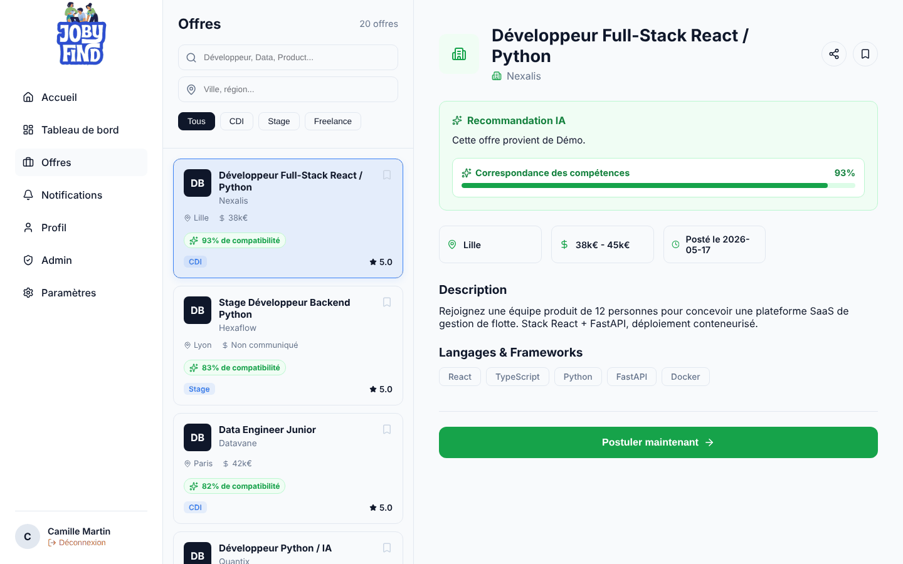
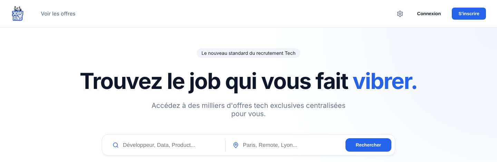
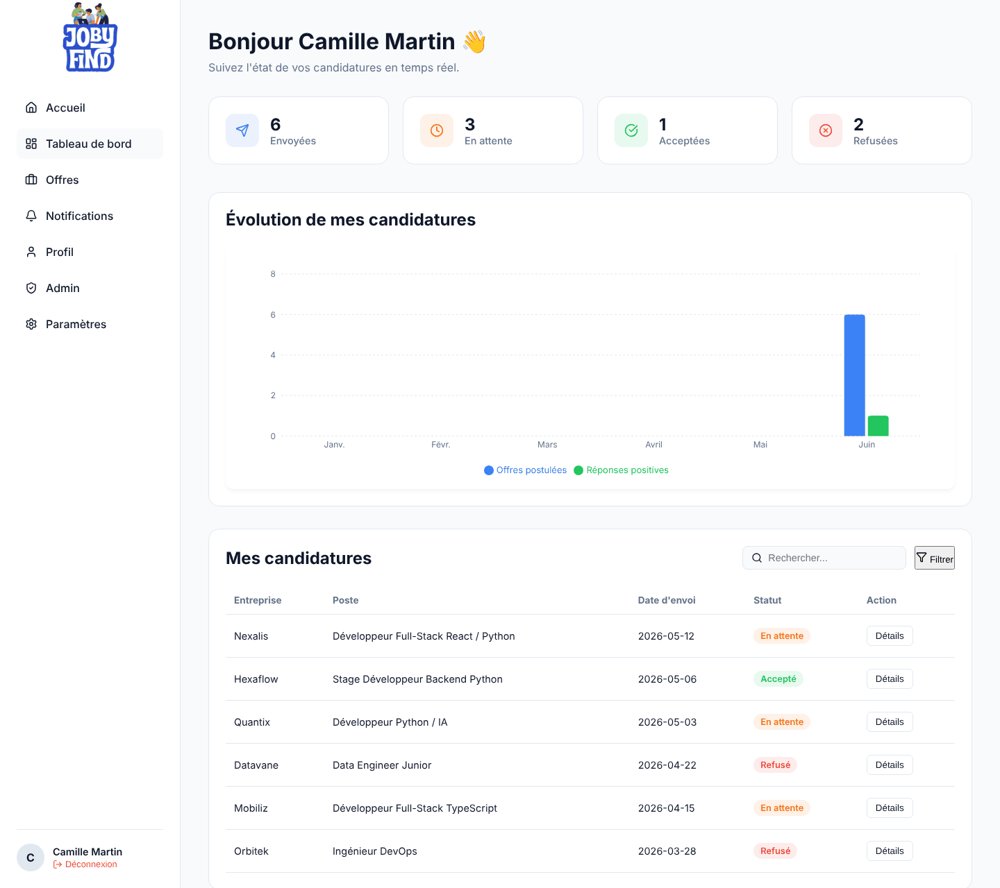
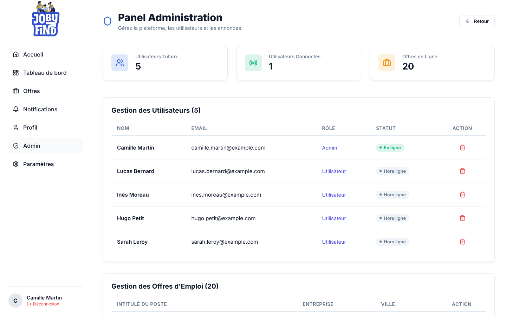
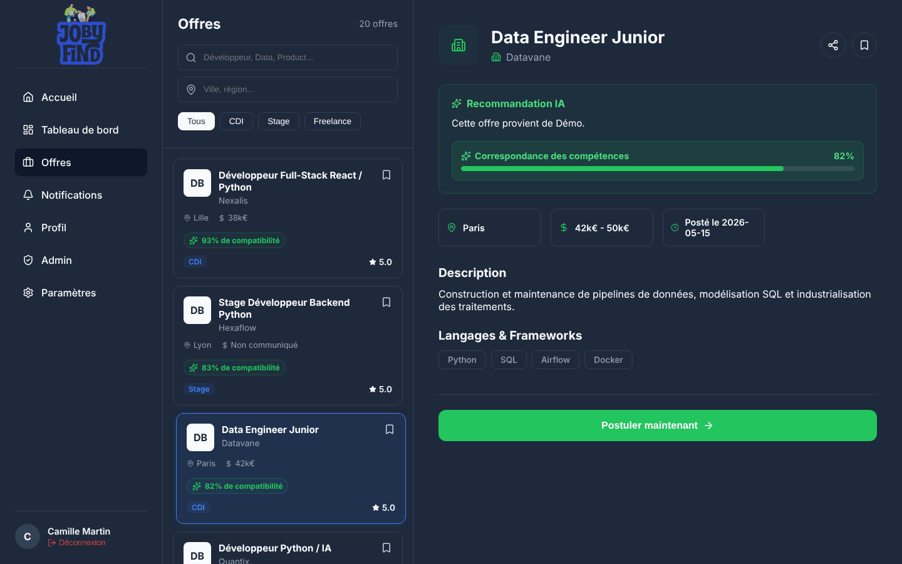
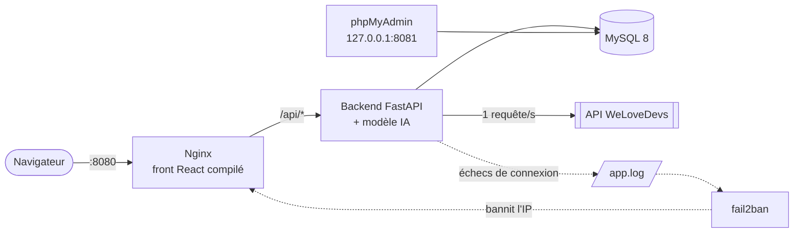
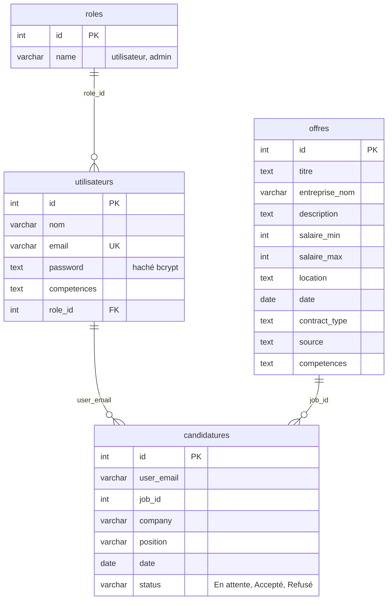

<h1 align="center">💼 JobyFind : agrégateur d'offres tech avec recommandations IA</h1>

<p align="center">
  Plateforme web qui collecte automatiquement les offres d'emploi, de stage et d'alternance de l'API <b>WeLoveDevs</b>,
  les normalise, puis les classe pour chaque utilisateur selon la compatibilité avec ses compétences.
</p>

<p align="center">
  
  
  
  
  
  
  
  
</p>

<p align="center">
  
</p>

---

## Sommaire

- [En bref](#en-bref)
- [Fonctionnalités](#fonctionnalités)
- [Captures d'écran](#captures-décran)
- [Architecture](#architecture)
- [Recommandation IA](#recommandation-ia)
- [Installation et lancement](#installation-et-lancement)
- [API REST](#api-rest)
- [Modèle de données](#modèle-de-données)
- [Sécurité](#sécurité)
- [Intégration continue](#intégration-continue)
- [Structure du dépôt](#structure-du-dépôt)
- [Limites et pistes d'amélioration](#limites-et-pistes-damélioration)
- [Équipe](#équipe)

## En bref

Projet de groupe réalisé en 1<sup>re</sup> année à **Epitech** (module B-YEP-200, programme *Build It For Real*), en partenariat avec **WeLoveDevs**.

Les offres tech sont dispersées sur de nombreux sites, et un étudiant doit les lire une par une pour savoir si elles correspondent à son profil.
JobyFind centralise ces offres dans une seule interface et met en avant celles qui correspondent le mieux aux compétences de l'utilisateur.

| | |
| :--- | :--- |
| **Source de données** | API WeLoveDevs : collecte au démarrage puis toutes les 30 minutes, dans le respect de la limite d'une requête par seconde |
| **IA** | Modèle multilingue `paraphrase-multilingual-MiniLM-L12-v2` (Sentence-Transformers), similarité cosinus entre profil et offres |
| **Stack** | React + TypeScript (Vite), API FastAPI, MySQL 8, Nginx, Docker Compose, fail2ban, GitHub Actions |
| **Déploiement local** | Une commande : `docker compose up --build` |

## Fonctionnalités

**Offres**
- Collecte automatique des offres WeLoveDevs, normalisation (dates, salaires, lieux, types de contrat) et dédoublonnage en base
- Recherche par mots-clés et par ville, filtres par type de contrat (CDI, stage, alternance, freelance)
- Carte interactive des offres (Leaflet), avec géocodage des villes via l'API Adresse du gouvernement
- Score de compatibilité IA sur chaque offre, et liste triée de la plus à la moins pertinente

**Espace candidat**
- Inscription en plusieurs étapes avec choix des compétences, connexion par jeton JWT
- Candidature en ligne avec envoi de CV et lettre de motivation
- Tableau de bord : compteurs (envoyées, en attente, acceptées, refusées), graphique et historique des candidatures
- Offres favorites et profil modifiable

**Administration**
- Panel réservé au rôle admin : liste et suppression des utilisateurs et des offres

**Accessibilité et confort**
- Mode sombre, 6 langues (français, anglais, espagnol, allemand, arabe, chinois)
- Mode daltonien, texte agrandi, lecteur vocal intégré

## Captures d'écran

> Captures réalisées sur l'application, alimentée par le [jeu de données de démonstration](demo/offres-demo.sql) (entreprises fictives).

| Accueil | Tableau de bord |
| :---: | :---: |
|  |  |
| **Administration** | **Mode sombre** |
|  |  |

## Architecture



- **Nginx** sert le build React et relaie les appels `/api/` vers le backend.
- **La base MySQL** n'est joignable que depuis le réseau interne `backend_network`. phpMyAdmin et l'API ne sont exposés que sur `127.0.0.1`.
- **Le backend** lance la collecte au démarrage, puis toutes les 30 minutes dans une tâche asynchrone. Le modèle IA est chargé une seule fois, au démarrage.
- **fail2ban** lit les échecs de connexion écrits par l'API et bannit une IP après 5 échecs en 10 minutes.

Les choix techniques sont détaillés dans les [Architecture Decision Records](docs/adr/).

## Recommandation IA

Pour chaque utilisateur, l'API calcule un score de compatibilité entre son profil et toutes les offres :

1. **Profil** : les compétences saisies à l'inscription (par exemple `React, TypeScript, Docker`) sont transformées en vecteur (*embedding*).
2. **Offres** : chaque offre est résumée en un texte (titre, compétences, entreprise et début de la description), puis encodée par lots de 64.
3. **Score** : la similarité cosinus entre les deux vecteurs est ramenée sur une échelle de 0 à 100 %, et les offres sont triées par score décroissant.

Le modèle `paraphrase-multilingual-MiniLM-L12-v2` remplace la première version anglophone (`all-MiniLM-L6-v2`), parce que la majorité des offres sont rédigées en français.
Il tourne sur CPU, sans GPU ni appel à une API externe, ce qui respecte les contraintes du projet (modèle de moins de 500 Mo, aucun service d'IA tiers).
Le détail est dans l'[ADR-005](docs/adr/ADR-005-feature-ia.md).

## Installation et lancement

**Prérequis** : Docker et Docker Compose.

```bash
git clone https://github.com/klasken/Jobaggregator.git
cd Jobaggregator
cp .env.example .env        # puis renseigner les valeurs
docker compose up --build
```

| Service | Adresse |
| :--- | :--- |
| Application | http://localhost:8080 |
| Documentation interactive de l'API (Swagger) | http://localhost:8000/docs |
| phpMyAdmin | http://127.0.0.1:8081 |

> Le premier lancement prend plusieurs minutes : l'image du backend installe PyTorch (CPU), puis le modèle IA est téléchargé au démarrage.

### Configuration (`.env`)

| Variable | Rôle |
| :--- | :--- |
| `WELOVEDEVS_API_KEY` | Clé de l'API WeLoveDevs, fournie dans le cadre du partenariat Epitech. Sans clé, l'application démarre mais ne collecte aucune offre. |
| `MYSQL_ROOT_PASSWORD` | Mot de passe root de MySQL |
| `MYSQL_DATABASE`, `MYSQL_USER`, `MYSQL_PASSWORD` | Base et compte utilisés par l'API |

Si le fichier `.env` est absent, Docker Compose utilise des valeurs de test pour MySQL.

### Données de démonstration

Pour essayer l'application sans clé WeLoveDevs, chargez 20 offres fictives une fois les conteneurs démarrés :

```bash
docker compose exec -T db sh -c 'mysql -u"$MYSQL_USER" -p"$MYSQL_PASSWORD" "$MYSQL_DATABASE"' < demo/offres-demo.sql
```

Créez ensuite un compte depuis l'application. Pour accéder au panel d'administration, donnez-lui le rôle admin :

```bash
docker compose exec db sh -c 'mysql -u"$MYSQL_USER" -p"$MYSQL_PASSWORD" "$MYSQL_DATABASE" -e "UPDATE utilisateurs SET role_id = 2 WHERE email = '\''votre@email.fr'\''"'
```

Reconnectez-vous ensuite pour que le menu « Admin » apparaisse.

### Développement du front sans Docker

```bash
cd front-end
npm install
npm run dev
```

## API REST

| Méthode | Route | Description |
| :--- | :--- | :--- |
| `POST` | `/api/register` | Création de compte (mot de passe haché avec bcrypt) |
| `POST` | `/api/login` | Connexion, renvoie un jeton JWT valable 30 minutes |
| `GET` | `/api/dashboard/jobs?location=&contract=` | Liste des offres, avec filtres optionnels |
| `GET` | `/api/dashboard/stats` | Nombre total d'offres et nombre de CDI |
| `GET` | `/api/recommendations/{email}` | Offres triées par score de compatibilité IA |
| `GET` `PUT` | `/api/dashboard/user/{email}` | Lecture et mise à jour du profil |
| `POST` | `/api/applications` | Candidature (formulaire multipart avec CV) |
| `GET` | `/api/applications/{email}` | Candidatures d'un utilisateur |
| `POST` | `/api/fetch` | Déclenche une collecte WeLoveDevs immédiate |
| `GET` `DELETE` | `/api/admin/users`, `/api/admin/users/{id}` | Gestion des utilisateurs |
| `GET` `DELETE` | `/api/admin/jobs`, `/api/admin/jobs/{id}` | Gestion des offres |

La documentation complète et testable est générée par FastAPI sur `/docs`.

## Modèle de données



Une contrainte d'unicité sur le couple *(titre, entreprise)* empêche qu'une offre déjà collectée soit insérée une seconde fois.
Le schéma est créé automatiquement au premier lancement par [`data.sql`](data.sql).

## Sécurité

| Menace | Mesure en place |
| :--- | :--- |
| Vol de mots de passe | Hachage **bcrypt** (passlib), aucun mot de passe stocké en clair |
| Injection SQL | Toutes les requêtes sont **paramétrées** (`%s` avec mysql-connector) |
| Données invalides | Validation des entrées par **Pydantic** (format d'email, types) |
| Force brute sur la connexion | Chaque échec est journalisé avec l'IP réelle du client. **fail2ban** bannit l'IP 10 minutes après 5 échecs. |
| Exposition de la base | MySQL isolé sur un réseau Docker interne. phpMyAdmin et l'API ne sont accessibles qu'en local. |
| Fuite de secrets | Clé d'API et identifiants dans `.env`, exclu du dépôt ([`.env.example`](.env.example) fourni) |

Le détail des choix est dans [docs/security/security-choices.md](docs/security/security-choices.md).

<details>
<summary>Vérifier que fail2ban fonctionne (Linux)</summary>

```bash
# 6 tentatives de connexion avec un mauvais mot de passe
for i in $(seq 6); do
  curl -s -o /dev/null -w "%{http_code}\n" -X POST http://localhost:8080/api/login \
    -H "Content-Type: application/json" -d '{"email":"test@test.fr","password":"faux"}'
done

docker compose exec fail2ban fail2ban-client status jobaggregator   # l'IP apparaît dans « Banned IP list »
docker compose exec fail2ban fail2ban-client unban --all             # lever le bannissement
```

</details>

## Intégration continue

Le workflow GitHub Actions [`.github/workflows/main.yml`](.github/workflows/main.yml) s'exécute à chaque push sur `main` et `develop` et à chaque pull request :

1. Analyse statique du backend avec **flake8** (erreurs de syntaxe et noms non définis)
2. Construction de l'image Docker du **backend**
3. Construction de l'image Docker du **frontend** (vérification TypeScript puis build Vite)
4. Validation du fichier **docker-compose.yml**

## Structure du dépôt

```
.
├── backend/                 API FastAPI
│   ├── api.py               Routes, collecte WeLoveDevs et normalisation
│   ├── routes.py            Inscription, connexion, journalisation fail2ban
│   ├── auth.py              Hachage bcrypt et génération des JWT
│   ├── database_api.py      Requêtes MySQL
│   └── feature_ia.py        Recommandation par similarité sémantique
├── front-end/               Application React + TypeScript (Vite), servie par Nginx
│   └── src/pages/           Accueil, offres, tableau de bord, profil, admin, paramètres
├── jail.d/                  Configuration fail2ban (jail et filtre)
├── docs/                    ADR, documentation produit, sécurité, captures
├── demo/                    Offres fictives pour tester sans clé d'API
├── data.sql                 Schéma de la base
├── docker-compose.yml       Front, back, MySQL, phpMyAdmin, fail2ban
└── .env.example             Variables d'environnement à renseigner
```

## Limites et pistes d'amélioration

- **Contrôle d'accès côté serveur** : le jeton JWT est généré à la connexion, mais les routes d'administration et de profil ne le vérifient pas encore. Prochaine étape : une dépendance FastAPI qui valide le jeton et le rôle sur chaque route protégée.
- **Clé de signature JWT** : elle est définie dans le code. Elle doit être lue depuis `.env`, comme les autres secrets.
- **CORS** : l'API accepte toutes les origines. Il faudra la restreindre au domaine du front.
- **Compétences des offres** : elles sont extraites lors de la normalisation mais pas encore enregistrées en base, alors qu'elles amélioreraient les recommandations.
- **Performances de l'IA** : les vecteurs des offres sont recalculés à chaque demande. Les stocker en base après la collecte rendrait les recommandations instantanées.
- **Fonctionnalités à finaliser** : stockage des CV reçus, mise à jour du statut des candidatures depuis l'interface, notifications réelles (la page affiche pour l'instant des exemples).
- **Tests** : ajouter des tests unitaires sur la normalisation des offres et le calcul des scores, puis les lancer dans la CI.

## Équipe

| Membre | Rôle |
| :--- | :--- |
| **Marius Ceugniet** | Backend, base de données, IA |
| **Sacha Bouron** | Frontend, maquettes, accessibilité |
| **Loïs Ekollo** | Architecture, conteneurisation, CI et sécurité opérationnelle |
| **Gauthier Lebrun** | Documentation produit et technique |
